# File Collector

Тестовое задание Intern C++ SafeBoard 2026
Реализация потокобезопасного класса `FileCollector`, который собирает файлы, передаваемые чанками в произвольном порядке.
**GitHub:** [github.com/Fedor2005/FileCollector](https://github.com/Fedor2005/FileCollector)

## Содержание

- [Task](#task)
- [Стек](#стек)
- [Сборка и тесты](#сборка-и-тесты)
- [API](#api)
- [Решение](#решение)
- [NonOverlappingIntervals](#nonoverlappingintervals)
- [Ограничения](#ограничения)
- [Структура проекта](#структура-проекта)
- [Контакты](#контакты)

## Task

Нужно реализовать потокобезопасный класс `FileCollector`, который собирает файлы из чанков. Каждый чанк содержит данные и позицию в файле. Чанки приходят в произвольном порядке, могут пересекаться и повторяться, а один файл могут одновременно дописывать несколько потоков. Класс должен эффективно хранить полученные данные, правильно обрабатывать разрывы, пересечения и дубликаты и минимизировать блокировки и копирование. Интерфейс получения файла нужно было спроектировать самостоятельно: он должен позволять читать файл частично и целиком, без лишнего копирования и безопасно при конкурентном доступе. Решение покрыто тестами на GoogleTest, включая многопоточные, сборка через CMake или Bazel.


## Стек

- C++20 (concepts, `std::format`, `std::span`, `std::latch` в тестах)
- CMake ≥ 3.16, Bazel (bzlmod)
- GoogleTest, ThreadSanitizer, gcov/gcovr


## Сборка
Linux:
CMake
```bash
mkdir build && cd build
cmake ..
make
```

Bazel
```bash
bazel build //...
```

Windows:
CMake
```powershell
mkdir build
cd build
cmake ..
cmake --build .
```
Bazel
```powershell
bazel build //...
```

## Тесты

### CMake
Для CMake рекомендуется использовать отдельную директорию `build`.

**Стандартная сборка и тесты:**
```bash
mkdir build && cd build
cmake ..
make
ctest
```

**Сборка с Thread Sanitizer (TSAN):**
```bash
mkdir build && cd build
cmake .. -DUSE_TSAN=ON
make
ctest
```

**Сборка с покрытием кода (Coverage):**
```bash
mkdir build && cd build
cmake .. -DENABLE_COVERAGE=ON
make
ctest
make coverage
```

### Bazel
Bazel работает из корня проекта.

**Стандартная сборка и тесты:**
```bash
bazel build //...
bazel test //...
```

**Сборка с TSAN:**
```bash
bazel test --config=tsan //...
```

**Сборка с покрытием (Coverage):**
```bash
bazel coverage //...
```

### Windows (MSVC)

CMake
```powershell
mkdir build; cd build; cmake ..; cmake --build . --config Debug
ctest -C Debug
```

Bazel
```powershell
bazel build //...
bazel test //...
```

## API

```cpp
namespace fc {
using FileData = std::shared_ptr<const std::vector<uint8_t>>;

class FileCollector {
public:
  void CollectFile(uint32_t fileId, size_t fileSize);
  void OnNewChunk(uint32_t fileId, size_t pos, std::vector<uint8_t> &&chunk);

  bool     IsComplete(uint32_t fileId) const;
  size_t   GetFileSize(uint32_t fileId) const;
  FileData GetFile(uint32_t fileId) const;
  size_t   Read(uint32_t fileId, size_t pos, std::span<uint8_t> out) const;
  std::vector<Interval<size_t>> GetFilledIntervals(uint32_t fileId) const;
};
}
```

| Метод | Что делает |
|---|---|
| `CollectFile` | Регистрирует файл и выделяет буфер. Повторный вызов с тем же размером ничего не делает, с другим бросает `FileIdAlreadyUse`. |
| `OnNewChunk` | Записывает в буфер только ещё не полученные байты чанка. Дубликаты и пересечения обрабатываются без перезаписи. Выход за границы файла даёт `ChunkOutOfRange`. |
| `IsComplete` | `true`, если получены все байты. |
| `GetFile` | Отдаёт собранный файл без копирования: `shared_ptr<const vector>` на внутренний буфер. Пока файл не собран, бросает `FileNotFilled`. |
| `Read` | Частичное чтение: копирует в `out` непрерывный уже полученный участок, начиная с `pos`. Возвращает число скопированных байт, 0 если байт `pos` ещё не пришёл. |
| `GetFilledIntervals` | Снимок полученных интервалов `[begin, end)`. |

Все методы потокобезопасны. Ошибки сообщаются через `fc::Exception` с кодом `fc::ErrorCode`.

```cpp
fc::FileCollector c;
c.CollectFile(1, 10);
c.OnNewChunk(1, 0, {'A', 'B', 'C', 'D'});
c.OnNewChunk(1, 2, {'C', 'D', 'E', 'F'});
c.OnNewChunk(1, 6, {'G', 'H', 'I', 'J'});
if (c.IsComplete(1)) {
  fc::FileData file = c.GetFile(1); // ABCDEFGHIJ, без копирования
}
```

## Решение

**Хранение.** Под каждый файл в `CollectFile` сразу выделяется буфер полного размера, и чанк копируется прямо на свою позицию. Склейка в конце не нужна: файл собирается на месте. Какие байты уже получены, хранит `NonOverlappingIntervals<size_t>` — `std::map<begin, end>` из непересекающихся интервалов. Её размер зависит от числа разрывов, а не от числа чанков: когда файл собран, в ней остаётся один интервал.

**Пересечения и дубликаты.** Для нового чанка `uncovered_intervals` находит участки, которых ещё нет. Копируются только они, затем весь диапазон чанка одной операцией добавляется в карту интервалов. Повторный чанк ничего не копирует. Уже записанные байты не перезаписываются, что корректно, потому что по условию содержимое файла не меняется.

**Блокировки.**
- Карта `fileId → FileState` защищена `std::shared_mutex`. Поиск файла (все вызовы `OnNewChunk` и методы чтения) берёт разделяемую блокировку, поэтому потоки не мешают друг другу. Эксклюзивную блокировку берёт только `CollectFile`.
- `FileState` хранится в `shared_ptr`. Блокировку карты отпускают сразу после поиска, дальше поток работает только с мьютексом своего файла. Потоки, которые пишут в разные файлы, друг друга не блокируют.
- Записи в один файл сериализуются его мьютексом. Под ним находятся непокрытые участки, копируются байты и обновляются интервалы.

**Чтение без лишних копий.** Когда записан последний байт, под мьютексом выставляется `std::atomic<bool> complete` с `memory_order_release`. `GetFile` и `IsComplete` читают флаг с `acquire`. Если читатель увидел `true`, ему видны все записи в буфер, а новых записей уже не будет. Поэтому собранный файл раздаётся любому числу читателей как `shared_ptr<const vector>`, без копирования и без мьютекса. Недособранный буфер наружу не отдаётся: в него ещё пишут другие потоки, и чтение было бы гонкой данных.

Для частичного чтения во время сборки есть `Read`: он копирует данные под мьютексом файла и только из уже полученных участков. Для собранного файла `Read` работает без блокировки.

**Сложность** (n — число интервалов в карте, k — число интервалов, которые задел чанк):
- `OnNewChunk`: O(log n + k + размер чанка);
- `Read`: O(log n + размер чтения);
- `GetFile`, `IsComplete`: O(1) после поиска файла.

**Тесты** (67 штук):
- `NonOverlappingIntervals`: слияние, касание и вложение интервалов, поиск разрывов; рандомизированная сверка с наивной моделью «bool на каждый байт».
- `FileCollector`: пример из задания, обратный порядок, дубликаты, пересечения, разрывы, ошибки, частичное чтение.
- Многопоточные: много писателей в один файл; много файлов параллельно; одновременная регистрация одного id; чтение во время записи (`ReadWhileWriting`); `GetFile` никогда не отдаёт недособранный файл. Многопоточные тесты прогоняются под ThreadSanitizer (`-DUSE_TSAN=ON`).

## Ограничения

- Буфер выделяется под полный размер файла сразу в `CollectFile` и заполняется нулями, поэтому память расходуется сразу под весь файл. Для очень больших файлов лучше подошёл бы `mmap` или хранение по страницам.
- Копирование чанка идёт под мьютексом файла, поэтому потоки, которые пишут в разные части одного файла, копируют по очереди. Можно было бы под блокировкой резервировать непокрытые участки, копировать без блокировки и затем фиксировать результат. Я этого не делал: усложнение заметно, а выигрыш есть только для больших чанков.
- Файл нельзя удалить из коллектора, поэтому память освобождается только вместе с объектом `FileCollector`.
- Нет блокирующего ожидания завершения сборки (например, `WaitFile` на `condition_variable`): потребитель опрашивает `IsComplete`.

## Структура проекта

```text
FileCollector
├── .bazelrc
├── .bazelversion
├── BUILD.bazel
├── CMakeLists.txt
├── MODULE.bazel
├── README.md
├── img
│   ├── add_interval_merge_example.svg
│   └── uncovered_intervals_example.svg
├── include
│   ├── Exception.hpp
│   ├── FileCollector.hpp
│   ├── NonOverlappingIntervals.hpp
│   └── NonOverlappingIntervals.tpp
├── src
│   ├── Exception.cpp
│   └── FileCollector.cpp
└── test
    ├── FileCollectorTest.cpp
    └── NonOverlappingIntervalsTest.cpp
```

## NonOverlappingIntervals

Шаблонный класс `NonOverlappingIntervals<T>` хранит множество непересекающихся полуинтервалов `[begin, end)` в `std::map<T, T>`. Соседние и пересекающиеся интервалы при вставке сливаются, поэтому в карте всегда минимальное число интервалов. Требование к `T` — полный порядок (`std::totally_ordered`).

- `add_interval(interval)` добавляет интервал и сливает его со всеми, которые он задевает или с которыми соприкасается.

  

- `uncovered_intervals(interval)` возвращает части интервала, которые ещё не покрыты.

  


## Контакты

- **Имя:** Фёдор Михалев
- **Email:** [f.v.mikhalev@mail.ru](mailto:f.v.mikhalev@mail.ru)
- **Telegram:** [@mikhfv](https://t.me/mikhfv)
- **GitHub:** [github.com/Fedor2005](https://github.com/Fedor2005)

## О себе

Фёдор Михалев, я студент 4 курса НИЯУ МИФИ (Программная инженерия, ИИКС). Подаюсь в Safeboard на C++, DevOps и системный анализ, приоритет — C++.

На C++20 пишу библиотеку структур данных и алгоритмов: контейнеры, умные указатели, сортировки, сборка через CMake, тесты на Google Test. Реализовал внешнюю сортировку файлов до 5 ГБ и сравнил производительность своих контейнеров с эталонными (github.com/Fedor2005).

В учебно-исследовательской работе разрабатываю REST-сервис на Scala с PostgreSQL (JSONB, триггеры), собираю Docker-образ и разворачиваю его в Kubernetes через Helm. В курсовых проектировал схемы БД. Пять лет работаю в Linux.

В Kaspersky меня привлекает исследовательская сторона: хочу глубже понимать, как системы устроены на низком уровне, и применять это в реальных задачах. Готов уделять стажировке 40 часов в неделю.

